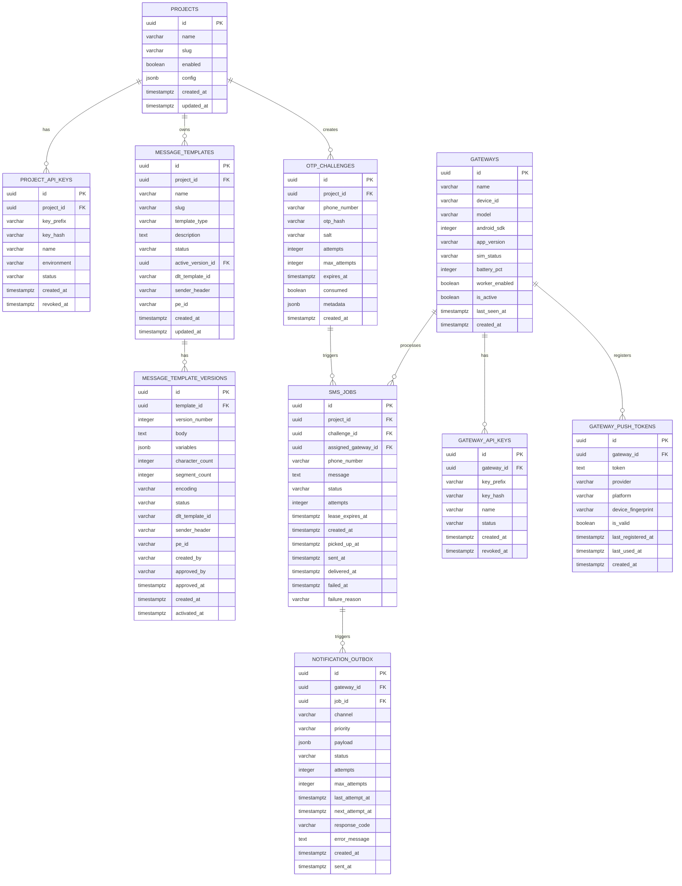

# Swift — Data Model & Schema Proposal

## 1. Relational Entity Overview



---

## 2. Table Definitions & Field Specifications

### 2.1 `projects`
Represents client applications (e.g., CivicFix, Hostix).
- `id` (UUID, Primary Key): Unique identifier.
- `name` (VARCHAR(100), NOT NULL): Human-readable name.
- `slug` (VARCHAR(50), UNIQUE, NOT NULL): URL-safe identifier (e.g., `civicfix`).
- `enabled` (BOOLEAN, DEFAULT TRUE): Master switch for project access.
- `config` (JSONB, DEFAULT '{}'): Rate limit overrides, default OTP expiry, templates.
- `created_at` (TIMESTAMPTZ, DEFAULT NOW()).
- `updated_at` (TIMESTAMPTZ, DEFAULT NOW()).

### 2.2 `project_api_keys`
API credentials issued to projects. Plaintext keys are never stored.
- `id` (UUID, Primary Key).
- `project_id` (UUID, FK -> `projects.id`, ON DELETE CASCADE).
- `key_prefix` (VARCHAR(20), NOT NULL): Public display prefix (e.g., `otp_proj_live_a1b2`).
- `key_hash` (VARCHAR(64), NOT NULL, UNIQUE): SHA-256 hash of the complete plaintext key.
- `name` (VARCHAR(100)): Friendly label (e.g., `CivicFix Production Server`).
- `environment` (VARCHAR(20), DEFAULT 'live'): `live` or `test`.
- `status` (VARCHAR(20), DEFAULT 'ACTIVE'): `ACTIVE`, `REVOKED`, `EXPIRED`.
- `created_at` (TIMESTAMPTZ, DEFAULT NOW()).
- `revoked_at` (TIMESTAMPTZ, NULLABLE).

### 2.3 `otp_challenges`
Tracks OTP tokens and verification attempts.
- `id` (UUID, Primary Key).
- `project_id` (UUID, FK -> `projects.id`, ON DELETE RESTRICT).
- `phone_number` (VARCHAR(20), NOT NULL): E.164 formatted telephone number.
- `otp_hash` (VARCHAR(64), NOT NULL): SHA-256 salted hash of generated numeric token.
- `salt` (VARCHAR(32), NOT NULL): Cryptographically random cryptographic salt.
- `attempts` (INTEGER, DEFAULT 0): Failed validation attempts counter.
- `max_attempts` (INTEGER, DEFAULT 3): Maximum allowed failed verification tries.
- `expires_at` (TIMESTAMPTZ, NOT NULL): Expiry deadline (e.g., +300 seconds).
- `consumed` (BOOLEAN, DEFAULT FALSE): Set `TRUE` upon successful verification.
- `metadata` (JSONB, DEFAULT '{}'): Caller contextual metadata (e.g., user ID, purpose).
- `created_at` (TIMESTAMPTZ, DEFAULT NOW()).

### 2.4 `sms_jobs`
SMS dispatch queue and delivery state machine.
- `id` (UUID, Primary Key).
- `project_id` (UUID, FK -> `projects.id`, ON DELETE RESTRICT).
- `challenge_id` (UUID, NULLABLE, FK -> `otp_challenges.id`, ON DELETE SET NULL).
- `assigned_gateway_id` (UUID, NULLABLE, FK -> `gateways.id`, ON DELETE SET NULL).
- `phone_number` (VARCHAR(20), NOT NULL): Destination phone number.
- `message` (TEXT, NOT NULL): Full rendered SMS body.
- `status` (VARCHAR(20), DEFAULT 'QUEUED', NOT NULL):
  - `QUEUED`: Waiting for an Android gateway worker to pick up.
  - `CLAIMED`: Leased to a gateway worker for transmission.
  - `SENDING`: Worker has passed payload to Android `SmsManager`.
  - `SENT`: Android OS confirmed message radio transmission.
  - `DELIVERED`: Carrier returned SMS delivery receipt intent.
  - `FAILED`: Transmission failed (no cellular signal, invalid number, or terminal carrier error).
  - `EXPIRED`: OTP challenge expired before any gateway worker claimed the job.
- `attempts` (INTEGER, DEFAULT 0): Number of lease claim iterations.
- `lease_expires_at` (TIMESTAMPTZ, NULLABLE): Stale job claim deadline (e.g., claimed + 60s).
- `created_at` (TIMESTAMPTZ, DEFAULT NOW()).
- `picked_up_at` (TIMESTAMPTZ, NULLABLE).
- `sent_at` (TIMESTAMPTZ, NULLABLE).
- `delivered_at` (TIMESTAMPTZ, NULLABLE).
- `failed_at` (TIMESTAMPTZ, NULLABLE).
- `failure_reason` (TEXT, NULLABLE).

### 2.5 `gateways`
Registered Android physical gateway devices.
- `id` (UUID, Primary Key).
- `name` (VARCHAR(100), NOT NULL): Friendly device name (e.g., `Gateway-Pixel-Primary`).
- `device_id` (VARCHAR(100), UNIQUE): Unique hardware installation identifier.
- `model` (VARCHAR(100)): Android device model (e.g., `Pixel 7a`).
- `android_sdk` (INTEGER): Compile/Target SDK version.
- `app_version` (VARCHAR(20)): Android Gateway APK version string.
- `sim_status` (VARCHAR(20)): `READY`, `ABSENT`, `NETWORK_LOCKED`, `ERROR`.
- `battery_pct` (INTEGER): Battery charge level (0-100).
- `worker_enabled` (BOOLEAN, DEFAULT TRUE): Remote override toggle for worker.
- `is_active` (BOOLEAN, DEFAULT TRUE): Master activation flag.
- `last_seen_at` (TIMESTAMPTZ, NULLABLE): Heartbeat / polling timestamp.
- `created_at` (TIMESTAMPTZ, DEFAULT NOW()).

### 2.6 `gateway_api_keys`
API credentials issued specifically to physical Android Gateway devices.
- `id` (UUID, Primary Key).
- `gateway_id` (UUID, FK -> `gateways.id`, ON DELETE CASCADE).
- `key_prefix` (VARCHAR(20), NOT NULL): Display prefix (e.g., `otp_gw_live_c3d4`).
- `key_hash` (VARCHAR(64), NOT NULL, UNIQUE): SHA-256 hash of plaintext gateway key.
- `name` (VARCHAR(100)): Label.
- `status` (VARCHAR(20), DEFAULT 'ACTIVE'): `ACTIVE`, `REVOKED`.
- `created_at` (TIMESTAMPTZ, DEFAULT NOW()).
- `revoked_at` (TIMESTAMPTZ, NULLABLE).

### 2.7 `message_templates`
Message templates per project supporting lifecycle states (`DRAFT`, `APPROVED`, `ACTIVE`, `ARCHIVED`).
- `id` (UUID, Primary Key).
- `project_id` (UUID, FK -> `projects.id`, ON DELETE CASCADE).
- `name` (VARCHAR(100), NOT NULL).
- `slug` (VARCHAR(100), NOT NULL, UNIQUE per project).
- `template_type` (VARCHAR(30), DEFAULT 'OTP'): `OTP`, `TRANSACTIONAL`, `MARKETING`, `NOTIFICATION`.
- `description` (TEXT, NULLABLE).
- `status` (VARCHAR(20), DEFAULT 'DRAFT'): `DRAFT`, `APPROVED`, `ACTIVE`, `ARCHIVED`.
- `active_version_id` (UUID, NULLABLE, FK -> `message_template_versions.id`).
- `dlt_template_id` (VARCHAR(50), NULLABLE): Indian telecom DLT template ID.
- `sender_header` (VARCHAR(15), NULLABLE): Telecom sender header (e.g., `SWIFTG`).
- `pe_id` (VARCHAR(50), NULLABLE): Principal Entity ID for regulatory compliance.
- `created_at` (TIMESTAMPTZ, DEFAULT NOW()).
- `updated_at` (TIMESTAMPTZ, DEFAULT NOW()).

### 2.8 `message_template_versions`
Immutable version history for message templates.
- `id` (UUID, Primary Key).
- `template_id` (UUID, FK -> `message_templates.id`, ON DELETE CASCADE).
- `version_number` (INTEGER, NOT NULL): Incremental sequence (1, 2, 3...).
- `body` (TEXT, NOT NULL): Template text with approved placeholders (`{{otp}}`, `{{app_name}}`, `{{expiry_minutes}}`).
- `variables` (JSONB, NOT NULL): Extracted placeholders array.
- `character_count` (INTEGER, NOT NULL): Calculated telecom character count.
- `segment_count` (INTEGER, NOT NULL): Estimated SMS parts.
- `encoding` (VARCHAR(10), NOT NULL): `GSM_7` or `UCS2`.
- `status` (VARCHAR(20), DEFAULT 'DRAFT'): `DRAFT`, `APPROVED`, `ACTIVE`, `ARCHIVED`.
- `dlt_template_id` (VARCHAR(50), NULLABLE).
- `sender_header` (VARCHAR(15), NULLABLE).
- `pe_id` (VARCHAR(50), NULLABLE).
- `created_by` (VARCHAR(100), NULLABLE).
- `approved_by` (VARCHAR(100), NULLABLE).
- `approved_at` (TIMESTAMPTZ, NULLABLE).
- `created_at` (TIMESTAMPTZ, DEFAULT NOW()).
- `activated_at` (TIMESTAMPTZ, NULLABLE).

### 2.9 `gateway_push_tokens`
Stores push notification tokens (FCM, HMS, APNS) for Android gateway devices to enable event-driven push wakeup.
- `id` (UUID, Primary Key).
- `gateway_id` (UUID, FK -> `gateways.id`, ON DELETE CASCADE).
- `token` (TEXT, NOT NULL): Cloud messaging device token.
- `provider` (VARCHAR(20), DEFAULT 'FCM'): `FCM`, `HMS`, `APNS`.
- `platform` (VARCHAR(20), DEFAULT 'ANDROID'): `ANDROID`, `IOS`, `WEB`.
- `device_fingerprint` (VARCHAR(128), NULLABLE).
- `is_valid` (BOOLEAN, DEFAULT TRUE).
- `last_registered_at` (TIMESTAMPTZ, DEFAULT NOW()).
- `last_used_at` (TIMESTAMPTZ, NULLABLE).
- `created_at` (TIMESTAMPTZ, DEFAULT NOW()).

### 2.10 `notification_outbox`
Guaranteed transactional delivery queue for outbound push notifications to gateway devices.
- `id` (UUID, Primary Key).
- `gateway_id` (UUID, FK -> `gateways.id`, ON DELETE SET NULL).
- `job_id` (UUID, FK -> `sms_jobs.id`, ON DELETE CASCADE).
- `channel` (VARCHAR(20), DEFAULT 'FCM'): `FCM`, `WEBHOOK`, `SYSTEM`.
- `priority` (VARCHAR(10), DEFAULT 'HIGH'): `HIGH`, `NORMAL`.
- `payload` (JSONB, NOT NULL): Message envelope (action, job_id, etc.).
- `status` (VARCHAR(20), DEFAULT 'PENDING'): `PENDING`, `PROCESSING`, `SENT`, `FAILED`, `DEAD_LETTER`.
- `attempts` (INTEGER, DEFAULT 0).
- `max_attempts` (INTEGER, DEFAULT 5).
- `last_attempt_at` (TIMESTAMPTZ, NULLABLE).
- `next_attempt_at` (TIMESTAMPTZ, DEFAULT NOW()).
- `response_code` (VARCHAR(50), NULLABLE).
- `error_message` (TEXT, NULLABLE).
- `created_at` (TIMESTAMPTZ, DEFAULT NOW()).
- `sent_at` (TIMESTAMPTZ, NULLABLE).

---

## 3. High-Performance Indexing Strategy

1. **Job Queue Polling Index:**
   ```sql
   CREATE INDEX idx_sms_jobs_queued ON sms_jobs (status, created_at) WHERE status = 'QUEUED';
   ```
2. **Stale Lease Recovery Index:**
   ```sql
   CREATE INDEX idx_sms_jobs_stale_claims ON sms_jobs (status, lease_expires_at) WHERE status = 'CLAIMED';
   ```
3. **Key Hash Lookups:**
   ```sql
   CREATE INDEX idx_project_api_keys_hash ON project_api_keys (key_hash, status);
   CREATE INDEX idx_gateway_api_keys_hash ON gateway_api_keys (key_hash, status);
   ```
4. **Active Challenge Lookups:**
   ```sql
   CREATE INDEX idx_otp_challenges_verify ON otp_challenges (id, consumed, expires_at);
   ```
5. **Single Active OTP Template per Project Partial Unique Index:**
   ```sql
   CREATE UNIQUE INDEX idx_one_active_otp_template_per_project ON message_templates (project_id)
   WHERE template_type = 'OTP' AND status = 'ACTIVE';
   ```
6. **Single Active Version per Template Partial Unique Index:**
   ```sql
   CREATE UNIQUE INDEX idx_one_active_version_per_template ON message_template_versions (template_id)
   WHERE status = 'ACTIVE';
   ```
7. **Push Notification Outbox Dispatch Index:**
   ```sql
   CREATE INDEX idx_notification_outbox_pending ON notification_outbox (status, next_attempt_at)
   WHERE status IN ('PENDING', 'PROCESSING');
   ```

---

## 4. Phase 1 Corrections & Relational Invariants (Migration 005)

To guarantee zero cross-template version corruption and enforce bidirectional state consistency:

1. **Composite Foreign Key Ownership Invariant:**
   ```sql
   ALTER TABLE message_templates
   ADD CONSTRAINT fk_template_active_version
   FOREIGN KEY (id, active_version_id)
   REFERENCES message_template_versions (template_id, id)
   DEFERRABLE INITIALLY DEFERRED;
   ```
   Ensures `active_version_id` can **never** reference a version belonging to another template.

2. **Template-Version Status Invariant Triggers:**
   - `trg_enforce_template_active_version`: Deferred constraint trigger on `message_templates` enforcing that:
     - If `active_version_id IS NULL`, status must NOT be `ACTIVE`.
     - If `active_version_id IS NOT NULL`, template status MUST be `ACTIVE` (strictly rejects `DRAFT`, `APPROVED`, or `ARCHIVED` templates with non-null pointer), and the referenced version must belong to the template with status `ACTIVE`.
   - `trg_enforce_version_active_invariant`: Deferred constraint trigger on `message_template_versions` enforcing that when a version is set to `ACTIVE`, its parent template must exist, be `ACTIVE`, and point to it via `active_version_id`. Also prevents demoting an active version while the parent is still `ACTIVE` and pointing to it.
   - `trg_before_template_archive_clear_pointer`: `BEFORE UPDATE` trigger on `message_templates` setting `NEW.active_version_id := NULL` when transitioning to `ARCHIVED`.
   - `trg_cascade_template_archive`: `AFTER UPDATE` trigger on `message_templates` cascading `status = 'ARCHIVED'` to all non-archived versions.

3. **Pre-flight Sanitization & Audit Columns:**
   - Pre-flight cleanup in Migration 005 ensures every `ACTIVE` version that is not the deployed version of an `ACTIVE` parent template is demoted to `APPROVED`.
   - `message_template_versions` records `approved_by (VARCHAR(100))` and `approved_at (TIMESTAMPTZ)` populated on explicit owner approval, alongside `activated_at (TIMESTAMPTZ)`.
